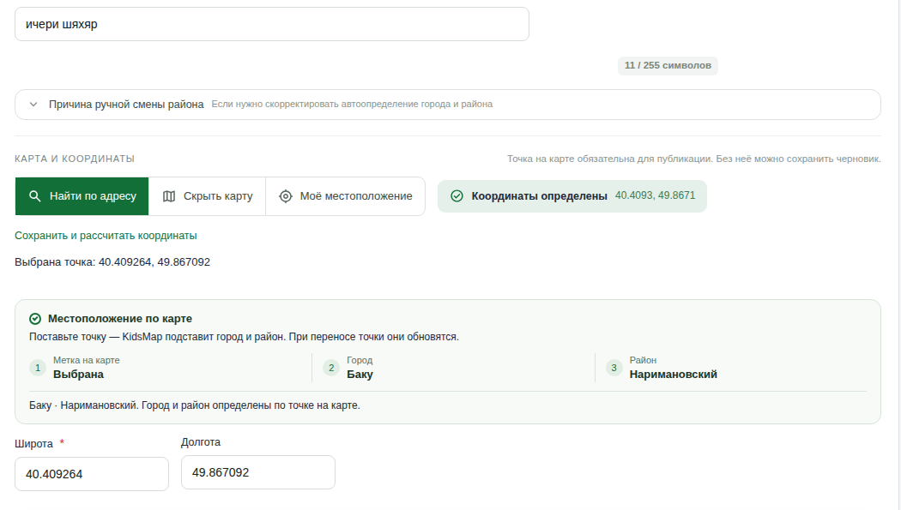

# Поиск координат места в админке KidsMap

## Исправление и повторная проверка

Исправлено в локальной рабочей копии 20 ноября 2026. В Chromium заново пройдены **37/37** сценариев в админке. На строке «ичери шяхяр» при пустом ответе после сохранения и повторного открытия широта, долгота и район остались пустыми. При точном ответе сохранились `40.366667, 49.833333` и Сабаильский район. Серверная кнопка отправила введённый адрес. Проверены также новая карточка, опубликованная карточка, выбор из двух точных совпадений и защита от запоздавшего ответа. Google в этом прогоне возвращал контролируемые тестовые данные. Выкладка в продакшен — отдельный этап.

На изолированной SQLite прошли **86/86** целевых тестов Django. Отдельно прошли **48/48** тестов JavaScript для формы поиска, определения района и общих кнопок карты. Регрессионные тесты покрывают округлённые координаты старых карточек, повторную отправку со старой версией формы и ручное подтверждение прежней точки. [Сохранение редакции](../../src/catalog/testcases/test_admin_geocoding_revision.py) · [Выбор результата](../../src/catalog/testcases/test_geocoding_provider.py) · [Поведение формы](../../scripts/tests/place_admin_geocoding.test.cjs)

## До исправления

20 ноября 2026. Проверена локальная рабочая копия на `e8f005ca0`. В редакторе воспроизведён адрес «ичери шяхяр» с координатами Наримановского района после сохранения и повторного открытия.



## Два способа воспроизвести

| Действие редактора | Что произошло |
|---|---|
| В существующей карточке с адресом «Нариманов» заменить адрес на «ичери шяхяр» и нажать **«Сохранить и рассчитать координаты»** | В исходящий запрос попало `Нариманов, baku_narimanov, Баку, Азербайджан`. Новый адрес остался в редакции. После повторного открытия админка показала новый адрес рядом со старой точкой `40.409264, 49.867092`. Проверено отдельными Django POST и GET для черновика и опубликованной карточки. |
| На карточке с точкой Наримановского района ввести **«ичери шяхяр»**, нажать **«Найти по адресу»**, получить пустой ответ, сохранить черновик и открыть его снова | Во время поиска видна ошибка. Обе координаты остались в форме. После открытия видны новый адрес, Наримановский район и зелёный статус «Координаты определены». Весь путь проверен в Chromium. На скриншоте выше результат этого случая. |

## Что сломано

| Приоритет | Где | Проверенное поведение |
|---|---|---|
| P1 | Серверный пересчёт при сохранении | На существующей карточке сервер геокодирует прежний адрес базовой записи. На новой карточке с заполненным адресом обращения к геокодеру вообще нет, интерфейс просит заполнить адрес. В обоих случаях редактируемая версия уже содержит введённый текст. Обработчик пишет результат в базовую запись. На опубликованной тестовой карточке пересчёт с приблизительным ответом действительно сдвинул точку из Сабаильского в Наримановский район. |
| P1 | Выбор результата в браузере и на сервере | Когда первым приходит приблизительный результат «Баку», а вторым более точное совпадение в Старом городе, форма выбирает город. Неверные координаты сохранились и снова открылись с пометкой «определены». При обратном порядке сервер выбрал Сабаильский район. Из двух улиц в разных районах сервер также взял первую без подтверждения. |
| P2 | Новый адрес, пустой ответ и старые данные | Ошибка поиска оставляет прежние координаты, район и ранее найденный адрес. Ответ без геометрии может оставить даже сообщение об успешном выборе. Старую точку можно сохранить вместе с новым адресом. |
| P2 | Два поиска подряд и очистка точки | Поздний ответ первого поиска перезаписал точку от второго. В другом запуске поздний ответ вернул точку после кнопки «Очистить». Оба результата видны в браузере. |
| P2 | Ошибки поставщика и повреждённые ответы | Отказ доступа, лимит запросов и таймаут выглядят как отсутствие адреса. Если у первого совпадения нет координат, сервер пропускает и следующее корректное. Для нечисловой широты и неожиданной структуры JSON подтверждены исключения. На уровне сервиса черновик принял `91, 181` с пометкой `invalid_coordinates`, опубликованная карточка сохранила прежнюю точку. |
| P3 | Массовое обновление в админке | Для опубликованной карточки с заполненным адресом и ответом за пределами покрытия точка защищена. В итоговом сообщении карточка попала в счётчик «без адреса». |

**Причина серверного пересчёта.** Админка сохраняет введённые поля в редакцию. Затем она заново читает базовую запись, а при создании берёт базовую запись с ещё пустым адресом. Обработчик геокодирования получает именно этот объект. Поисковая строка может включать также прежние район и метро, в том числе служебный код района. [Сохранение формы](../../src/catalog/domain_admin/place.py#L514) · [Обработчик кнопки](../../src/catalog/domain_admin/place_admin/operations.py#L227) · [Составление запроса](../../src/catalog/services/geocoding.py#L35)

**Причина выбора координат.** Браузер и сервер берут первый результат. Обработчик кнопки в браузере применяет его без сверки с текущим адресом и последующим действием редактора. На сервере у опубликованной записи проверяется попадание в покрываемый район, поэтому приблизительная точка внутри Баку проходит. [Браузер](../../static/admin/js/kidsmap_place_location.js#L414) · [Разбор ответа](../../src/catalog/repositories/geocoding_repositories.py#L42) · [Запись координат](../../src/catalog/services/geocoding.py#L89)

## Что работает

| Проверка | Результат |
|---|---|
| Точка Старого города `40.366667, 49.833333` | Сервер и форма определили Сабаильский район. После сохранения и повторного открытия значения совпали. [Контрольная точка ЮНЕСКО](https://whc.unesco.org/en/list/958/maps/) |
| Новая пустая точка, пустой поисковый запрос и пустая выдача без ранее выбранной точки | Координаты остаются пустыми. Само открытие карты не присваивает Наримановский район. |
| Поиск клавишей Enter и выбор подсказки с точным ответом | Появились ожидаемые широта, долгота и Сабаильский район. |
| Ручной ввод, события клика карты и перетаскивания маркера | Район меняется при переносе. Ручной ввод работает и при недоступном Google Maps SDK. |
| Точка за пределами покрытия, переставленные широта и долгота контрольной точки, широта 91° в форме | По таким значениям форма не присваивает район Баку. |
| Очистка без ожидающего ответа поисковика | Координаты исчезли. После сохранения и повторного открытия оба поля остались пустыми. |
| Вьюпорт 390 × 844, получение и отказ геопозиции устройства | Точный результат поиска и тестовая геопозиция заполнили координаты. При отказе показано сообщение. Очистка работает. |
| Проверки границ районов | Штатные тесты прошли для общей границы, пересечения полигонов, внутреннего отверстия, точки вне покрытия и неверных координат. |

## Итог браузерных сценариев

**34 сценария, 26 прошли, 8 воспроизвели нежелательное поведение.** Несколько проверок фиксируют один дефект на разных этапах, в том числе до сохранения и после повторного открытия.

| Где проверяли | Прошли | С ошибкой | Что входило |
|---|---:|---:|---|
| Раздел адреса на экране 1440 × 950 | 13 | 6 | Начальное состояние, поиск, подсказка, перенос, подтверждение, очистка и проверка координат. Ошибки проявились при приблизительном ответе, пустом ответе после выбранной точки, отказе сервиса, ответе без геометрии и в двух случаях с опоздавшим ответом. |
| Браузерное сохранение черновика и повторное открытие | 2 | 2 | Точная и очищенная точки сохранились правильно. В двух других случаях сохранились устаревшая точка и приблизительное совпадение по городу. |
| Экран 390 × 844 | 4 | 0 | Поиск, разрешённая и отклонённая геопозиция, очистка. |
| Недоступный SDK | 2 | 0 | Поиск отключён, ручные координаты определяют район. |
| Новая форма, пересчёт с заданной точкой и языки | 5 | 0 | На новой форме поля изначально пусты, затем заполняются через «Найти по адресу». При заранее заданном точном ответе серверной кнопки браузер показал эту точку после открытия. Языки AZ и EN показывают район как «Səbail» и «Sabail». Русский проверен в основной матрице. Выбор **текста запроса** серверной кнопкой отдельно проверен тремя тестами с перехватом исходящего адреса. |

## Условия и повторение проверки

- Полный экран редактора постоянного места открыт в Chromium с тестовой сессией администратора. Сохранения прошли через штатные формы, обработчики Django, отдельную SQLite и повторный GET. Поиск Google и геопозиция устройства получили заданные тестовые ответы, чтобы проверить порядок, задержки и отказ. Функция определения района, JS формы и обработчики сохранения работали из проекта.
- Штатные тесты прошли **43/43** в Django и **34/34** в JavaScript. В JS это 22 проверки определения района и 12 проверок общих контролов карты владельца. В Django проверены геометрия, назначение района, геокодирование, команда пересчёта и связанные сценарии админки и владельца.
- Дополнительно выполнены 22 проверки обработки ответа провайдера, 5 проверок сохранения на уровне сервиса и 3 целевых проверки кнопки пересчёта на первом сохранении, черновике и опубликованной карточке. Все три проверки контракта кнопки воспроизвели дефект. Эти три результата относятся к одной причине.
- Отдельный публичный запрос OpenStreetMap по «ичери шяхяр» вернул пустой список. По «İçərişəhər» первый результат — станция метро в Сабаильском районе. Админка использует Google, и конкретный ответ Google в исходном сеансе редактора неизвестен. [Найденная станция в OpenStreetMap](https://www.openstreetmap.org/node/11622641267)
- Производственный сайт, записи пользователей, реальный Google SDK с ключом проекта и GPS физического телефона в проверку не входили. PostgreSQL, другие браузеры и полный регрессионный набор проекта не запускались.

## Критерии приёмки исправления

1. Для новой карточки, черновика и опубликованной карточки геокодер получает введённый адрес. Результат сохраняется в ту же редакцию. Публичная точка меняется только после принятия редакции.
2. При неоднозначном совпадении или результате только по городу редактор видит найденное место и может подтвердить точку. Такой ответ сам по себе не помечает координаты как определённые.
3. После замены адреса старая точка требует повторного подтверждения. Пустой или ошибочный ответ оставляет понятное состояние и после сохранения. Кнопка очистки и более поздний поиск имеют приоритет над запоздавшим ответом.
4. Сервер проверяет структуру ответа и диапазоны координат до записи. Редактор получает разные сообщения для пустого результата и сбоя сервиса.


## Команды проведённого прогона

Штатные JS-тесты запускались из корня проекта.

```sh
KIDSMAP_JSDOM=/home/ramin/kidsmap/.tmp/phone-dom/node_modules/jsdom node scripts/test_location_resolution.cjs
KIDSMAP_JSDOM=/home/ramin/kidsmap/.tmp/phone-dom/node_modules/jsdom node scripts/test_owner_place_map_picker.cjs
```

Скрипты конкретного прогона остались во временных каталогах этой машины. Серверные тесты создают новую in-memory SQLite для каждого запуска. Контрактные тесты `projection` и `newcard` на проверенном срезе завершаются ошибкой проверки введённого адреса.

```sh
cd /tmp/kidsmap-address-backend-CXtwWaa2
env -i PATH=/usr/bin:/bin DJANGO_TESTING=1 PYTHONDONTWRITEBYTECODE=1 /home/ramin/kidsmap/.venv/bin/python probe.py
env -i PATH=/usr/bin:/bin DJANGO_TESTING=1 DJANGO_SETTINGS_MODULE=qa_settings PYTHONPATH=/home/ramin/kidsmap/src:/home/ramin/kidsmap /home/ramin/kidsmap/.venv/bin/python -m django test projection newcard edge2
```

Браузер проверял редактор на `127.0.0.1`. Во временном каталоге `/tmp/kidsmap-geo-admin-p4ZOgC5E` использовались `./qa-exec server.py` и режимы `node run.cjs ui`, `round`, `clearonly`, `mobile`, `offline`, `extra`. Сценарий очистки из прохода `round` завершён отдельно через `clearonly` после таймаута навигации. Для скриншота `node proof.cjs` повторил сохранение с буквальным адресом «ичери шяхяр».
